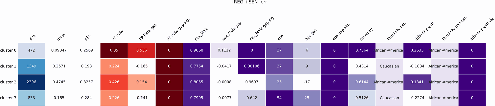
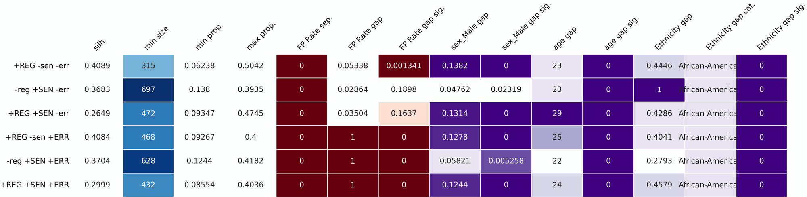

# Clustering 4 Fairness

[](https://pypi.org/project/c4fairness/)
[](https://pypi.org/project/c4fairness/)

**Discover where a model's errors fall unevenly.** `c4fairness` clusters the rows of a
model's test set and reports how prediction-error disparities and sensitive-attribute
composition vary across the discovered clusters — surfacing under-served subgroups
*without* pre-specifying the protected group. Works for **binary**, **multi-class**, and
**regression** tasks.

Made at **Vrije Universiteit Amsterdam (VU)**, co-funded by **University of
Twente (UT)**.

📄 Paper: [*c4fairness: A Python Package for Clustering-based Fairness Analysis*](https://openreview.net/forum?id=OXTzc01W72) (BNAIC/BeNeLearn 2026) · [Cite](#citation)

---

## Install

```bash
pip install c4fairness              # from PyPI
pip install "c4fairness[web]"       # + the Gradio web UI
pip install "c4fairness[r]"         # + rpy2 
```

Or from a local checkout (editable, for development):

```bash
pip install -e .
```

The import name is `c4fairness`; the CLI command is `c4fairness` (equivalently
`python -m c4fairness.main`).

---

## Quick start

```bash
c4fairness --data_path docs/datasets/compas_audit.csv \
    --regular_cols age,priors_count \
    --sensitive_cols sex,race,age --continuous_sensitive_cols age \
    --error_col errors --error_type binary \
    --algorithm kmeans --n_clusters 4 --seed 42
```

This clusters the test set on `age`/`priors_count` (+ the sensitive columns), then writes a
per-cluster recap and heatmap showing each cluster's error rate and its `sex`/`race`/`age`
make-up. String sensitive columns (`sex`, `race`) are one-hot encoded automatically.

---

## What the output looks like

Both heatmaps below come from a single experiment-mode run on the bundled COMPAS extract,
auditing a recidivism classifier's **false-positive rate**:

```bash
c4fairness --data_path docs/datasets/compas_audit.csv --experiment \
  --regular_cols age,priors_count \
  --sensitive_cols sex,race,age --continuous_sensitive_cols age \
  --y_true_col true_class --y_pred_col predicted_class --binary_error_metric fpr \
  --error_label "FP Rate" --multicat_table_option salient --sensitive_labels "race:Ethnicity" \
  --algorithm kmeans --n_clusters 4 --seed 42
```

### Detailed heatmap — one row per cluster

Condition `+REG +SEN -err`: clustered on the features and the sensitive attributes, not on
the error itself.



Cluster 0 holds 9.3% of the test set and carries an **FP Rate of 0.85** against 0.34 overall
— a gap of +0.54 at p ≈ 0. Its sensitive columns say who is in it: 76% African-American, 91%
male, median age 37. The other three clusters sit between 0.22 and 0.43. That is a disparity
localised to a pocket of the feature space, which a single per-race average would flatten.

### Overview heatmap — one row per condition

Experiment mode reruns the audit for every combination of feature groups (`REG` = regular
features, `SEN` = sensitive, `ERR` = the error column), so you can check whether a finding
survives the choice of what to cluster on.



Blue = cluster size, red = error, violet = sensitive composition; p-value columns render
darker the more significant they are. Conditions that include `ERR` cluster *on* the error,
so their `FP Rate gap` of 1.0 is expected, not a finding.

---

## Web UI

A [Gradio](https://www.gradio.app/) web app wraps the CLI: upload a CSV, assign column
roles, and run from the browser. Results (heatmaps, an overview table, downloadable CSVs)
render in tabs, with **Home**, **Documentation**, and **About** pages.

```bash
pip install "c4fairness[web]"
c4fairness-web
```

Then open the printed local URL (default http://localhost:7860). *Load example dataset*
fills the form with the bundled COMPAS extract if you just want to see it work.

Two run modes: **Single run** (the default) audits the one configuration on the form,
while **Full sweep** repeats it for every feature-group combination. The sweep is
several times slower. The form exposes every CLI option; algorithm-specific fields
(`eps`, `min_samples`, `max_iter`) appear only for the relevant algorithm, and the run
log streams while the job is running.

---

## Requirements

Python 3.10+. A virtual environment is recommended.

```bash
python -m venv venv
source venv/bin/activate        # Windows: venv\Scripts\activate
pip install -e .                # or: pip install c4fairness
```

Optional R setup for the exact Fisher test: see [Methodology](https://github.com/emma-ba/Clustering_4_Fairness/blob/main/docs/methodology.md#r-optional--exact-multi-categorical-fisher).

---

## Documentation

- [CLI reference](https://github.com/emma-ba/Clustering_4_Fairness/blob/main/docs/cli-reference.md): every option
- [Outputs](https://github.com/emma-ba/Clustering_4_Fairness/blob/main/docs/outputs.md): result table columns, significance tests, output folders
- [Examples and datasets](https://github.com/emma-ba/Clustering_4_Fairness/blob/main/docs/examples.md): binary, regression, Gower runs and the bundled data
- [Methodology notes](https://github.com/emma-ba/Clustering_4_Fairness/blob/main/docs/methodology.md): one-hot vs. scaling, kprototypes silhouette, optional R setup
- Worked notebooks: [`example_binary.ipynb`](https://github.com/emma-ba/Clustering_4_Fairness/blob/main/docs/example_binary.ipynb), [`example_regression.ipynb`](https://github.com/emma-ba/Clustering_4_Fairness/blob/main/docs/example_regression.ipynb)
- [Contributing](https://github.com/emma-ba/Clustering_4_Fairness/blob/main/CONTRIBUTING.md): dev setup and project layout

---

## Citation

If you use `c4fairness`, please cite:

```bibtex
@inproceedings{muntean2026cfairness,
  title={c4fairness: A Python Package for Clustering-based Fairness Analysis},
  author={Filip Muntean and Emma Beauxis-Aussalet},
  booktitle={The 38th Benelux Conference on Artificial Intelligence and the 35th Belgian Dutch Conference on Machine Learning},
  year={2026},
  url={https://openreview.net/forum?id=OXTzc01W72}
}
```
